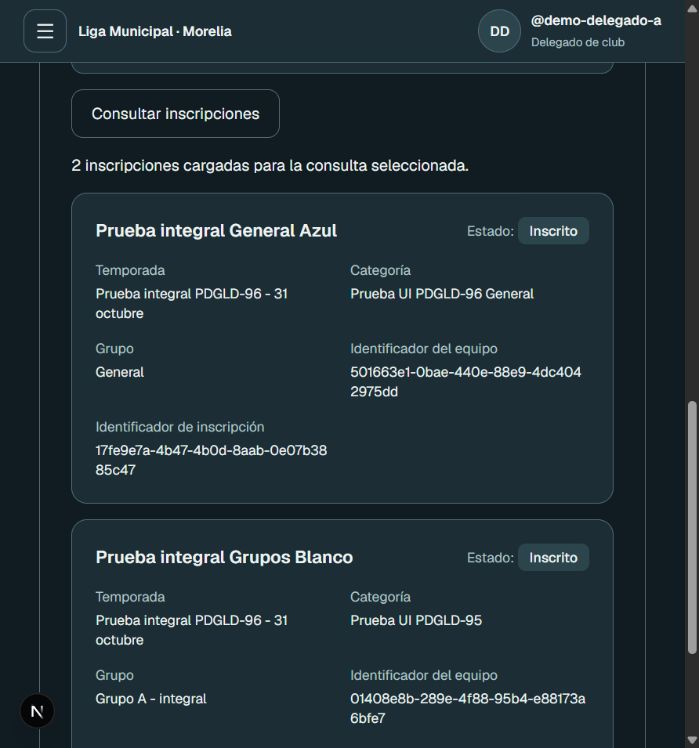

# PDGLD-38 — Configuración de competencia

Inicio: 28/10/2026. Base: develop e84ef5d, con PR #34 integrado.
Rama: feat/PDGLD-38-configuracion-competencia.

## Primer incremento: temporadas

Panel → Temporadas (`/competitions/seasons`): consulta por liga y creación
planificada de temporadas de fútbol, con nombre y fechas reales de calendario.
Se reutiliza `seasons`; no se cambian migraciones ni datos locales existentes.
El servicio verifica los permisos vigentes `competitions:READ/CREATE` en servidor
y el ámbito de liga, sin comparación fija con SUPERADMIN. Solo ligas activas.
Un permiso acotado a club no habilita la consulta completa de una liga.

Una transacción guarda temporada y auditoría. La restricción existente de nombre
único por liga/deporte protege envíos concurrentes. No se registra una segunda
auditoría de INSERT mediante trigger. Para UPDATE/DELETE existe audit_season;
el servicio conserva ese evento y no registra una segunda actualización manual.
La alta crea PLANNED/version 1; no permite activar, cerrar ni reabrir por formulario.
Las fechas de temporada no equivalen a ventanas de registro de jugadores.

`npm run test:competitions` utiliza el runner local existente: crea PostgreSQL
desechable, aplica migraciones, inicia Next.js y envía el formulario real mediante
su Server Action. Se comprueban consulta y aislamiento, autenticación, fechas,
permiso de creación, revocación con formulario abierto, duplicados concurrentes y
rollback ante fallo de auditoría. Se incorpora al job de PostgreSQL de CI.

Verificación local del primer incremento: 7 resultados de prueba aprobados;
lint, typecheck y build aprobados con Node 24.22.1. Turbopack informa su cambio a
childProcesses y completa la compilación. La base temporal se eliminó al terminar.
Todavía no se ejecutó aceptación visual de esta pantalla ni CI remoto de la rama.

## Segundo incremento: servidor de borradores versionados

Se incorpora consulta y alta de versiones DRAFT de convocatoria, puntuación,
desempates ordenados y calendario, con permisos READ/UPDATE, versión esperada y
bloqueo de la temporada. No agrega vistas. No aprueba ni aplica valores propuestos.
Contrato y pendientes: [configuración de competencia](../architecture/competition-configuration.md).

La suite `test:competitions` pasa 13 resultados: añade acceso privado por temporada,
permisos/origen, esquema estricto, historial intacto, carreras, rollback de reglas y
auditoría ante fallo de parámetros y rechazo de nuevas versiones sobre CLOSED.
Solo se modificó la base desechable del runner. No se ejecuta un cierre real sobre
datos del usuario para probar la barrera de escritura.

## Tercer incremento: catálogo y asociación de categorías

Contrato: [categorías de competencia](../architecture/competition-categories.md).
Sin nuevas vistas, se agregan alta/consulta de catálogo y asociación/consulta por
temporada con validación de liga, deporte, reglamento, permisos y versión.
La migración nueva permite preparar categorías con elegibilidad pendiente sin
inventar corte o edades. Solo se aplicó en bases desechables, no en gestor_ligas_dev.
Se corrigió un evento duplicado de UPDATE en la propuesta inicial de reglas:
el trigger audit_season ya registra ese cambio; una prueba exige un único evento.

Verificación del incremento: 23 resultados de competencias, 27 de afiliaciones,
30 de inscripción, 26 de controles CI y las suites de seed (19 + 7) aprobados.
Lint, typecheck y build aprobados. La prueba de migración ejecuta el archivo real
sobre una participación anterior dentro de una transacción desechable y comprueba
que conserva UUID, reglamento y fecha de corte, con indicador pendiente=false.
La reconstrucción desde
migraciones y su comparación con Prisma no detectaron diferencias. Las pruebas
de inscripción conservan datos legados y el historial de otra temporada.

## Cuarto incremento: grupos vacíos (29/10/2026)

Alta, consulta, renombrado y eliminación segura de grupos vacíos mediante servicios
y HTTP. Se comprueba temporada/participación, permisos vigentes, versión, cierre,
referencias y auditoría. Sin vistas nuevas ni migraciones adicionales. No se
declara completada la configuración de formatos o distribución de equipos.
`test:competitions`: 29 resultados aprobados, reconstrucción/migrate diff sin
diferencias; lint, typecheck y build aprobados. CI remoto no ejecutado.
Contrato: [grupos](../architecture/competition-groups.md).

## Trabajo restante

Incremento tabla general: 34 resultados de competencias aprobados. Formato por participación y General automático en
inscripción por HTTP, sin tocar vistas. Nueva migración con compatibilidad
LEGACY_GROUPS y restricción de único General. Pruebas de inscripción legada: 30
resultados aprobados; cliente de inscripción: 73 aprobados; lint/typecheck
aprobados. Contrato y límites: [tabla general](../architecture/competition-general-table.md).
Fase de grupos y distribución añadidas en el incremento del 30/10 descrito abajo;
no se declara completada la historia.

Avance de edición (29/10): PATCH de nombre/fechas para temporadas planificadas,
con permisos, motivo, versión y protección de calendario utilizado. Suite de
competencias: 31 resultados aprobados; lint y typecheck aprobados.
Contrato y límites del cierre: [edición de temporada](../architecture/competition-season-edit.md).

- Edición de categorías/participaciones; validación y aprobación de convocatoria
  y parámetros versionados. No aplicar automáticamente propuestas DRAFT.
- Cierre auditado con comprobación de pendientes: falta concretar qué trámites
  bloquean además de los partidos sin resolver y la autoridad pertinente. La
  preferencia del usuario es bloquear, sin inventar resultados por default.
- Pantallas integradas, coordinación con PDGLD-110 y pruebas de ambos formatos,
  permisos, concurrencia, cierre y regresión de afiliación/inscripción.

PV-04 queda pendiente de la consulta al profesor: documentos, ventanas, edades,
excepciones y participación entre categorías. No se codifican reglas de la
convocatoria histórica de 2024–2025 como reglas vigentes de 2026.

Este primer incremento no termina la historia ni sus subtareas. Faltan los puntos
anteriores, revisión independiente, CI remoto y evidencia de aceptación integrada.

## Incremento: inscripción pendiente y distribución (30/10/2026)

Avance posterior a la integración de origin/develop=fb64b4f (PR #36): conflicto de
acceso resuelto conservando el panel nuevo y enlace de temporadas autorizado.
Temporadas reutiliza ManagementShell y SelectField; las URL se conservan.
La distribución automática equilibrada está implementada por HTTP; contrato en
competition-distribution.md. 42 resultados de competencias aprobados, incluidos
balance con grupos ya ocupados, conservación de asignaciones/REGISTERED, rechazo
de delegado, concurrencia, rollback de auditoría y repetición sin nuevos cambios.
Lint y el comando habitual typecheck aprobados tras regenerar tipos de rutas y
retirar únicamente tipos generados obsoletos de las rutas anteriores. No se
modifican datos habituales ni se crea un commit de integración automáticamente.
Compilación complementaria con `next build --webpack` aprobada en este incremento;
no sustituye el build oficial con Turbopack ni el CI remoto.

Servidor implementado y contrato en
[fase de grupos](../architecture/competition-distribution.md). Sin nuevas vistas.
GROUP_STAGE conserva categoría y REGISTERED sin grupo hasta asignación autorizada.
GENERAL_TABLE y LEGACY_GROUPS conservan sus recorridos. Se adapta el contrato de
recuperación/listado, sin alterar cuerpos, claves o huellas anteriores.

Comprobaciones locales:

- Competencias: 41 resultados aprobados con HTTP y PostgreSQL reales, incluyendo
  permisos retirados, categoría desautorizada, un ganador concurrente y rollback
  de grupo/versión si falla auditoría. SQL rechaza partidos y clasificación sin
  grupo, reasignaciones y cambio de formato con historial.
- La migración real se ejecutó además sobre inscripciones previas dentro de una
  transacción revertida: categoría proyectada correctamente, temporadas cerradas,
  todos los demás campos/huellas y auditoría intactos, estado de triggers restaurado.
- Inscripciones existentes: 30 resultados aprobados; interfaz/adaptadores: 73;
  recuperación cliente: 12; seed: 19 + 7. Reconstrucción y comparación Prisma sin
  diferencias. Lint sin avisos y typecheck aprobados.
- `npm run build` falla al arrancar el proceso CSS de Turbopack
  (`node process exited before we could connect`, código 0), también al repetir
  con permisos ampliados. No se cambiaron dependencias ni configuración para
  ocultarlo. Comprobación complementaria `next build --webpack` aprobada,
  incluyendo TypeScript y generación de rutas. Confirmación del build oficial
  con Turbopack pendiente en CI; Webpack no lo sustituye.
- Referencia remota consultada nuevamente: origin/develop=e84ef5d, sin nuevos
  commits respecto de la base revisada. No se incorporó el borrador visual de Vic.

Solo bases desechables. No se aplicaron migraciones a gestor_ligas_dev/Supabase;
no hubo commit, push, publicación ni cambios en Jira. PDGLD-95 y aceptación visual
siguen pendientes, además de los criterios de negocio/revisión indicados arriba.

## Vistas de configuración (PDGLD-95)

Se incorpora `/competitions/seasons/[id]` al shell compartido, con enlace desde Temporadas. Consulta versiones de reglas y categorías; permite crear borradores, crear/asociar categorías, definir formato, editar temporada, mantener grupos vacíos y ejecutar distribución automática. Los formularios utilizan contratos HTTP reales, versión esperada y motivo; los diálogos reutilizan FormDialog y los selectores SelectField. Las capacidades se consultan en servidor y cada operación conserva su autorización independiente. Las respuestas inciertas bloquean el reenvío y ofrecen consultar de nuevo. El catálogo y las categorías conservan su contexto de liga/temporada.

Comprobación: 42/42 pruebas de competencias con PostgreSQL temporal; lint y typecheck satisfactorios; compilación Webpack satisfactoria. La consulta de grupos incorpora su número de inscripciones. Se verificó que origin/develop sigue integrado. Pendiente recorrido de navegador con datos reales (teclado, foco, móvil y temas), CI y revisión de otra persona. Las vistas no implementan el cierre ni las reglas PV-04 pendientes del servidor, ni declaran completa PDGLD-38.

### Recorrido local en navegador

Se detectó que iniciar con `next dev --webpack` compila sin procesar las utilidades Tailwind: este repositorio configura `@tailwindcss/turbopack`, sin plugin PostCSS para Webpack. Por tanto, el build Webpack anterior acredita compilación, pero no valida el diseño. Reiniciar con `npm run dev` (Turbopack) recuperó los estilos; desarrollo Turbopack respondió correctamente en este recorrido.

La base local gestor_ligas_dev en localhost:5433 tenía pendientes las tres migraciones PDGLD-38. Se aplicaron con migrate deploy, sin reset. En navegador, con la cuenta DEMO administrativa y backend real, se confirmó creación de borrador versión 1, alta de categoría Prueba UI PDGLD-95, asociación a DEMO Temporada 2026, selección de fase de grupos y creación mediante diálogo de Grupo de prueba UI. La temporada pasó de versión 1 a 5. Los datos sintéticos de este recorrido se conservaron en esa temporada local. El diálogo bloqueó los controles durante el envío y el grupo apareció con 0 inscripciones. No se modificó Supabase. Continúan pendientes pruebas del resto de operaciones/perfiles, ambos temas y escritorio, distribución con equipos desde navegador y CI.

### Comprobación de vistas y correcciones posteriores

- Presentación de reglas en español mediante RuleParameter: convocatoria, calendario, puntos y desempates, conservando estado de validación y valores; sin JSON crudo para estos parámetros.
- Navegador con backend/base local: edición del nombre de la temporada DEMO (versión 6), renombrado del grupo vacío (versión 7), advertencia de descarte y restablecimiento de captura. Intento de cambiar fecha con referencias rechazado; la versión permaneció en 7. Los datos DEMO del recorrido se conservan.
- Secretaría DEMO consulta y dispone de distribución; no ve alta/edición de reglas, categorías ni grupos. Distribución sin pendientes confirmó 0 asignaciones, sin incrementar versión. Delegado DEMO rechazado por URL directa; mensaje explícito de falta de permiso y enlace al panel.
- Revisión en navegador de tema claro y oscuro, móvil 390x844 y disposición de escritorio 1440x1000. Sin desbordamiento horizontal del documento en las dimensiones comprobadas. Se restauraron tamaño y tema del sistema. La revisión de teclado incluye menú con Escape y selectores; la prueba sintética verifica retorno de foco al disparador del diálogo.
- ConfigurationForm distingue errores concretos (por ejemplo fechas relacionadas) y respuesta incierta. Un 200 sin acuse válido no confirma éxito ni permite repetir el envío. El estado incierto se reserva para resultados no confirmados, separado de los rechazos y éxitos.
- Nueva prueba de React en navegador real con respuestas sintéticas: tests/e2e/competition-configuration.test.mjs. Ejecutar node --test tests/e2e/competition-configuration.test.mjs con CHROME_BIN configurado cuando sea necesario. Verifica doble envío, versión del payload, acuse inválido, mensaje de conflicto, bloqueo, descarte, limpieza, retorno de foco y reglas legibles. Pasó. Esta prueba no se incorpora automáticamente a CI por existir el archivo.
- Repetición de 42/42 pruebas de competencias con PostgreSQL temporal satisfactoria (incluye eliminación segura, grupos utilizados, reparto con equipos, concurrencia y rollback). Typecheck y lint satisfactorios. npm run build habitual con Turbopack completó correctamente; permanece el aviso de fallback de workerThreads a childProcesses, sin abortar esta compilación.
- Alcance pendiente: el recorrido completo en navegador solicitud/aprobación/inscripción/distribución con equipos no se repitió en esta tanda; reparto con equipos cubierto por integración de servidor, y envío del formulario por prueba de componentes. Revisión de otra persona y CI del PR siguen pendientes. Cierre de temporada y reglas PV-04 siguen fuera de las operaciones disponibles de servidor. No se cierra PDGLD-38 ni PDGLD-95 por estas comprobaciones locales.

## PDGLD-94: mantenimiento pendiente revisado

Se agregan servicios y endpoints para retirar una temporada vacía y editar/retirar una participación de categoría sin dependencias. Requieren competitions:UPDATE vigente, motivo, versión, sesión y mismo origen. Rechazan CLOSED, competencia iniciada, referencias, reglas de otra temporada y cambios de tipo/reglas sobre elegibilidad ya configurada. La identidad del catálogo se conserva. Todas las relaciones hijas del modelo se comprueban; no hay cascadas ni vaciado implícito de la temporada. Auditoría atómica sin duplicar audit_season. Contratos y límites en docs/architecture/competition-maintenance.md.

Pasaron 47/47 pruebas con PostgreSQL temporal, typecheck, lint y npm run build (Turbopack). Las nuevas pruebas están integradas en la suite test:competitions existente: autorización/origen/cuerpo estricto, versiones concurrentes, referencias, catálogo conservado, elegibilidad, ACTIVE/CLOSED y rollback tanto de categoría como de temporada cuando falla auditoría. No se modificaron migraciones, dependencias ni datos persistentes locales/remotos en esta tanda.

Aún faltan el proceso autorizado de cierre/correcciones de temporada y completar configuración/contrato de elegibilidad y ventanas para jugadores. El cierre conserva las preguntas documentadas en competition-season-edit.md (trámites, resultado definitivo, autoridad); no se habilita una transición con criterios inventados. Los nuevos controles de pantalla de mantenimiento corresponden a PDGLD-95 y siguen por integrar. Revisión, PR y CI pendientes; no cerrar PDGLD-94 por estas comprobaciones locales.
# Comprobación adicional — cierre, reglas de jugadores y controles (30/10/2026)

Esta sección actualiza los pendientes descritos en las tandas anteriores.

- Cierre ACTIVE → CLOSED con permiso vigente de actualización, confirmación
  explícita, motivo, versión y auditoría atómica. API y SQL bloquean partidos sin
  resultado definitivo; cerrada no admite reapertura ni el bypass histórico de
  corrección. Los partidos cancelados/no disputados no requieren marcador.
- Política de jugadores por participación: año de referencia, edades ordinarias,
  mínimo excepcional con decisión administrativa, documentos, días y zona de
  registro, jugadores en cancha y máximos opcionales de convocatoria/plantilla.
  Lectura interna transaccional para jugadores; las filas legadas no se habilitan.
- Vistas conectadas de edición/retirada segura de categorías, eliminación de
  temporada vacía, reglas de jugadores y cierre. El historial cerrado muestra la
  configuración y retira los formularios. Reutiliza el shell y los diálogos del equipo.
- Nueva migración aditiva aplicada en Docker local y bases temporales. Sin reset,
  edición de migraciones aplicadas, cambios en Supabase ni instalación de paquetes.
- El control de producción reconoce por checksum la tabla TEMP ON COMMIT DROP de
  la migración anterior de distribución. No acepta tablas arbitrarias ni SQL
  alterado; plan en `docs/architecture/competition-distribution-production-plan.md`.

Resultados locales:

| Comprobación | Resultado |
| --- | --- |
| Competencias con HTTP/PostgreSQL temporal | 51/51 |
| Edad y ventana de registro | 3/3 |
| Inscripción/regresión con HTTP/PostgreSQL temporal | 30/30 |
| Afiliaciones y revisión con HTTP/PostgreSQL temporal | 27/27 |
| Controles de pipeline/planes de migración | 27/27 |
| Formularios React en Chrome con respuestas sintéticas | 1/1 |
| Typecheck, lint, build habitual con Turbopack | Correctos |
| Diferencia Prisma/migraciones en base temporal | Ninguna |

Prueba manual con sesión/servidor/PostgreSQL locales: administrador guardó reglas
para la categoría de demostración existente (versión de temporada 7 → 8). También
se creó una temporada desechable ACTIVE, sin partidos, para confirmar cierre desde
el diálogo, versión 1 → 2 y retirada de los controles. No se cerraron temporadas
de negocio existentes. Los casos con partidos y rollback se verificaron por HTTP
y SQL en bases temporales, no se presentan como acciones manuales de navegador.
El servidor local se reinició para cargar el cliente Prisma regenerado.

Se integró `test:competition-ui` al workflow de aplicación y los casos nuevos de
servidor/reglas a `test:competitions`. Esto prepara CI; no significa que GitHub lo
haya ejecutado sobre estos cambios todavía locales.

Pendientes de cierre de las subtareas: publicar y revisar PR, CI remoto y recorrido
completo desde pantallas para ambos formatos (configuración → solicitud → aprobación
→ inscripción → distribución). Las suites HTTP y los formularios con respuestas
sintéticas no sustituyen ese criterio de PDGLD-96. El registro/expedientes de
jugadores debe consumir el contrato en sus tareas; no se declara implementado aquí.

## Recorrido integral confirmado desde pantallas — 31/10/2026

Se completó el recorrido manual que figuraba pendiente en la sección anterior,
con sesiones reales de administrador, delegado y Secretaría, servidor local y
PostgreSQL en Docker. No se simularon respuestas ni se insertó una afiliación ya
aprobada como fixture de este recorrido.

1. Administrador creó desde la pantalla la temporada «Prueba integral PDGLD-96 -
   31 octubre» (ce2b2dab-cd3d-434d-b547-47bdde3db1ff), convocatoria/reglas en
   borrador y dos categorías participantes usando el catálogo existente.
2. Configuró tabla general con su único General y fase de grupos con «Grupo A -
   integral». Se comprobó también la confirmación de ambos cambios en pantalla.
3. Delegado solicitó afiliación de DEMO Club A a ambas categorías. Las tres
   imágenes de firma, marcadas PRUEBA/SIN VALIDEZ, se cargaron y validaron mediante
   el servicio real de Storage privado configurado, con autorización expresa de
   Sergio. No contienen firmas ni datos personales reales. Folio nuevo:
   AFL-986d5098-983c-4435-807c-0c4b2b1e99c3.
4. Secretaría encontró el folio en la bandeja, seleccionó explícitamente ambas
   categorías y confirmó la aprobación; quedó su historial de revisión.
5. Delegado creó «Prueba integral General Azul»: se confirmó Inscrito y General
   sin seleccionar ni enviar groupId.
6. Delegado creó «Prueba integral Grupos Blanco»: se confirmó Inscrito y Pendiente
   de asignación, sin seleccionar ni enviar groupId.
7. Secretaría distribuyó el pendiente desde el diálogo de configuración. La
   temporada avanzó de versión 7 a 8 y Grupo A - integral pasó de 0 a 1 inscritos.
8. Una nueva sesión del delegado consultó ambas inscripciones: General y Grupo A -
   integral respectivamente, conservando el estado Inscrito y sus identidades.

Durante el recorrido se encontraron y corrigieron dos defectos de integración:

- El cambio de formato devolvía HTTP 200 sin id y el formulario interpretaba el
  acuse como incierto. Se añadió el identificador de participación a la respuesta;
  se comprobó de nuevo en pantalla y en la suite de servidor.
- El adaptador descartaba format y el formulario todavía exigía grupo manual.
  Ahora conserva el formato, oculta el selector en General/fase de grupos y omite
  groupId. Se conserva el comportamiento de grupos legados y el cuerpo original
  de operaciones pendientes, incluso al refrescar las opciones.

Comprobaciones tras las correcciones: competencias 51/51 y reglas puras 3/3;
formulario de inscripción 21/21, adaptador HTTP sintético 45/45, listado 5/5,
actividad de sesión 5/5 y regresión Chrome de selectores/modales/sesiones 1/1.
Typecheck, lint y build habitual con Turbopack correctos. La advertencia de
workerThreads usa la alternativa childProcesses y no detuvo la compilación.

Se conservan la temporada, afiliación, dos inscripciones y tres objetos privados
de prueba para revisión. No se modificó la base de datos de Supabase, no se
reiniciaron datos existentes y no se hicieron commit/push. El recorrido manual
queda resuelto; restan PR, revisión por otra persona, CI remoto e integración
conforme al DoD. No se cierran automáticamente las subtareas ni la historia.
